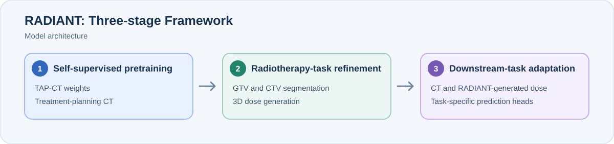
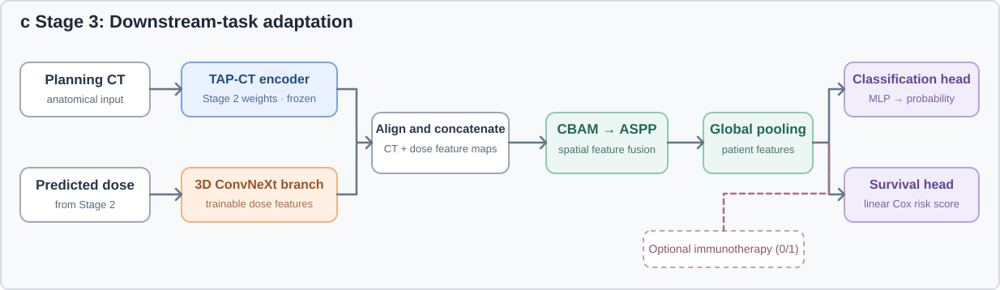

<div align="center">

# RADIANT

**Radiotherapy anatomy and dose representation learning**



</div>

RADIANT combines a CT foundation encoder with radiotherapy-specific target delineation and dose generation. The associated study used **119,782 radiotherapy cases from 13 centres** for model development and examined **17 clinical endpoints** across lung, oesophageal, rectal and cervical cancer cohorts. The code here covers data preparation, the core models, and training for the three stages shown below. Patient data and trained Stage 2 weights are not stored in this repository.

## Model

| Stage | Input | Model and output |
| --- | --- | --- |
| **1 · CT adaptation** | Treatment-planning CT | A TAP-CT Base 3D encoder is adapted with DINO, iBOT and KoLeo self-supervision. |
| **2 · Radiotherapy-task refinement** | CT and target geometry | A shared encoder and task-specific decoders jointly learn GTV segmentation, CTV segmentation and 3D dose generation. |
| **3 · Clinical prediction** | CT and RADIANT-generated dose | The frozen Stage 2 encoder is paired with a 3D ConvNeXt-style dose branch, CBAM, ASPP and a classification or survival head. |

### Stage 1 · CT adaptation

The encoder starts from the [public TAP-CT Base 3D model](https://huggingface.co/fomofo/tap-ct-b-3d). Student and teacher networks learn consistent representations across CT views, while masked-token prediction uses teacher targets. The adaptation loss combines DINO, iBOT and KoLeo objectives.


### Stage 2 · Target delineation and dose generation

The three tasks share a TAP-CT encoder. At inference, the cascade follows **CT → Pred-GTV → Pred-CTV → predicted dose**. The CTV model receives CT and Pred-GTV; the dose model receives CT, Pred-CTV and a distance map derived from Pred-CTV. During supervised training, clinical GTV and CTV contours provide the corresponding conditioning inputs. Dose is predicted by direct regression and is normalised to each patient's prescription dose, with values above 1 retained.


### Stage 3 · Downstream prediction

The CT branch uses the encoder obtained after Stage 2 training. A separate 3D ConvNeXt-style branch processes the **predicted** dose map. Their features are fused with CBAM and ASPP before a task-specific head for binary classification or time-to-event prediction. The CT encoder remains frozen during downstream training. An optional binary immunotherapy input can be concatenated with the pooled imaging features for lung cancer tasks.



*Stage 1 and Stage 2 diagrams are reproduced from Supplementary Fig. 2 of the accompanying manuscript. The Stage 3 schematic summarises the manuscript and this repository's implementation.*

## What is in this repository

```text
radiant/
├── data/          Patient manifests, aligned volumes and datasets
├── preprocess/    DICOM conversion and model-grid preparation
├── models/        TAP-CT interface, Stage 2/3 models and Stage 2 inference
└── training/      Stage 1–3 training and task losses
```

The preparation code aligns CT, structure masks and dose within each case. It clips CT to −1000 to 1000 HU, uses nearest-neighbour interpolation for masks, and divides dose by the plan's prescription dose. The default prepared field of view is **D × H × W = 96 × 336 × 336** voxels. An explicit voxel spacing can be supplied during preparation; the code does not impose one fixed spacing on every case.

The repository provides generic classification and survival training in Stage 3. Cohort-specific endpoint analyses, the manuscript's full evaluation suite and clinical data are not part of this code release.

## Getting started

Use Python 3.11 or newer. Install the dependencies in an environment with a PyTorch build suited to your hardware, then run commands from the repository root, which contains the `radiant/` package:

```bash
python -m pip install "torch>=2.5,<3" "numpy>=1.26,<3" "scipy>=1.12,<2" \
  "SimpleITK>=2.3,<3" "safetensors>=0.4,<1" "transformers>=4.45,<5" \
  "huggingface-hub>=0.26,<1" "pydicom>=2.4,<4" "rt-utils>=1.2,<3"
```

The main entry points are:

```bash
python -m radiant.preprocess.convert_dicom --help
python -m radiant.preprocess.prepare --help
python -m radiant.training.stage1 --help
python -m radiant.training.stage2 --help
python -m radiant.training.stage3 --help
python -m radiant.models.inference --help
```

Training uses patient manifests with fixed `train`, `val` and `test` assignments. The manifest reader checks that one patient does not appear in different splits. Local data paths, training configurations and the TAP-CT base-model files must be supplied by the user. To download the upstream model through the included helper, specify an audited 40-character TAP-CT commit:

```bash
python -m radiant.models.fetch_backbone --revision <UPSTREAM_COMMIT_SHA> --output <MODEL_DIR>
```

Stage 2 inference requires an approved Stage 2 checkpoint and an aligned planning CT volume:

```bash
python -m radiant.models.inference \
  --checkpoint <STAGE2_CHECKPOINT> \
  --model-dir <MODEL_DIR> \
  --ct <PLANNING_CT.nrrd> \
  --output <NEW_OUTPUT_DIRECTORY>
```

It writes predicted GTV and CTV masks and a prescription-normalised predicted dose volume on the input CT grid. The output directory must not already exist.

## Weights, data and citation

- **Stage 1 encoder:** [RADIANT Stage 1 Encoder on Hugging Face](https://huggingface.co/Ltcccccc/RADIANT-Stage1-Encoder). See its model card for the weight license and usage conditions.
- **Stage 2 weights:** For non-commercial research access, contact **[Zhen Zhang](mailto:Radiologyzhangzhen@gmail.com)** with your affiliation, proposed use and requested model components. Access is subject to institutional review and a model-use agreement.
- **Clinical data:** Multicentre data are controlled by their contributing institutions. RTOG 0617 data follow NCI data-access procedures; [Lung1](https://www.cancerimagingarchive.net/collection/nsclc-radiomics/) is available through TCIA.

If you use this work, please cite the accompanying manuscript: Zhang Z, et al. *RADIANT, a multicancer anatomy-dose foundation model for individualised radiotherapy benefit-risk stratification*. Full publication details will be added when available.

**Research use only.** The released models are not intended for autonomous clinical treatment planning.
