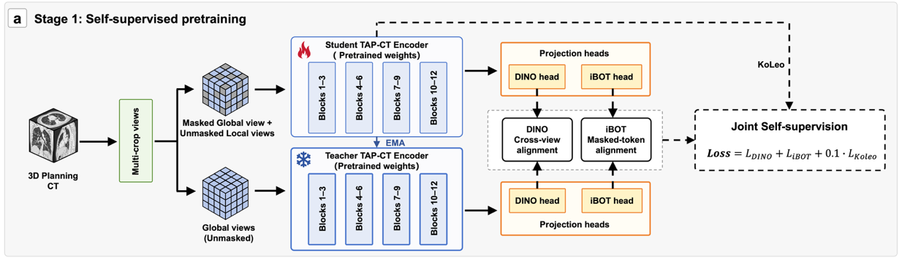
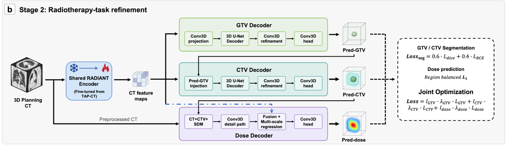
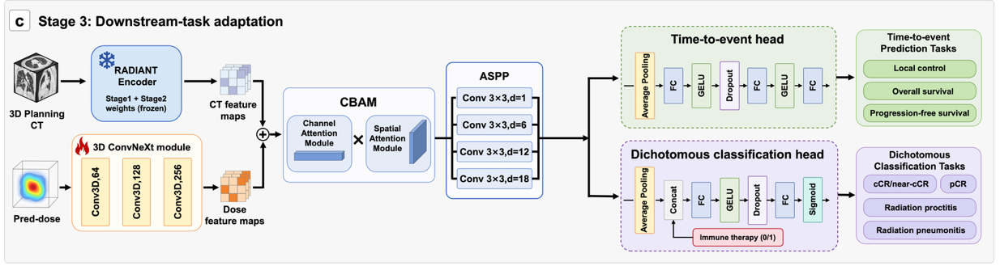

<div align="center">

# RADIANT

**RADIANT, a multicancer anatomy-dose foundation model for individualised radiotherapy benefit-risk stratification**


</div>

RADIANT (Radiotherapy Anatomy-Dose Integrated fouNdAtion representaTion) is a radiotherapy-specific foundation model for multicancer benefit-risk stratification. For foundation-model development, we assembled **119,782 adult external-beam radiotherapy cases from thirteen hospitals**. Downstream evaluation included multi-institutional cohorts in lung, oesophageal, rectal and cervical cancer. Across the four disease sites, **17 endpoints** were analysed.

## RADIANT development

RADIANT was developed using a two-stage framework based on the TAP-CT transformer encoder. For downstream clinical prediction, RADIANT-derived representations were adapted to each endpoint using task-specific prediction heads.

### Stage 1: self-supervised pretraining

In Stage 1, the encoder was initialised with [pretrained TAP-CT weights](https://huggingface.co/fomofo/tap-ct-b-3d) and adapted to treatment-planning CT volumes using DINO, iBOT and KoLeo self-supervision.



### Stage 2: radiotherapy-task refinement

In Stage 2, the pretrained encoder was refined through joint training on radiotherapy-specific tasks. The model first generated Pred-GTV from treatment-planning CT; Pred-CTV was then generated conditioned on CT and Pred-GTV; a 3D dose distribution was subsequently generated conditioned on CT and Pred-CTV. Clinical reference GTV and CTV contours were used as conditioning inputs during training; Pred-GTV and Pred-CTV were used during complete-cascade validation and testing. **Joint supervision from target delineation and dose generation was intended to help the shared encoder learn radiotherapy-relevant CT features.**



### Stage 3: downstream-task adaptation

The downstream model integrated anatomical features from treatment-planning CT with dose features derived from the RADIANT-generated dose distribution. The radiotherapy-task-refined RADIANT encoder was kept fixed, while the 3D ConvNeXt-style dose branch, fusion module and task-specific prediction heads were optimised. For lung cancer tasks, immunotherapy use could be included before the first fully connected layer.




## Data preprocessing

CT images, target masks and dose distributions were spatially aligned to the treatment-planning CT grid within each case. CT intensities were converted to Hounsfield units and scaled for model input. Dose distributions were normalised by the prescription dose of the corresponding treatment plan, while preserving local hotspots. The default prepared field of view is **96 × 336 × 336 voxels (depth × height × width)**.

## Code

```text
radiant/
├── data/          Manifests and datasets
├── preprocess/    DICOM conversion and volume preparation
├── models/        TAP-CT encoder, Stage 2 and Stage 3 models, and inference
└── training/      Stage 1, Stage 2 and Stage 3 training
```

Use Python 3.11 or newer. From the repository root, install the dependencies and inspect the available entry points:

```bash
python -m pip install "torch>=2.5,<3" "numpy>=1.26,<3" "scipy>=1.12,<2" \
  "SimpleITK>=2.3,<3" "safetensors>=0.4,<1" "transformers>=4.45,<5" \
  "huggingface-hub>=0.26,<1" "pydicom>=2.4,<4" "rt-utils>=1.2,<3"

python -m radiant.preprocess.convert_dicom --help
python -m radiant.preprocess.prepare --help
python -m radiant.training.stage1 --help
python -m radiant.training.stage2 --help
python -m radiant.training.stage3 --help
python -m radiant.models.inference --help
```

Training requires a patient manifest, local data paths, model files and a task-specific configuration. The manifest reader checks that a patient does not appear in different data splits. Patient data and cohort-specific analyses are not distributed in this repository.

## Code and data availability

- **Stage 1 encoder weights:** [RADIANT Stage 1 Encoder](https://huggingface.co/Ltcccccc/RADIANT-Stage1-Encoder) on Hugging Face.
- **Stage 2 weights:** Researchers at non-profit academic or healthcare institutions may apply for access for non-commercial research. Applications should be sent to [Zhen Zhang](mailto:Radiologyzhangzhen@gmail.com) and include institutional affiliation, the proposed research and requested model components. Approved access requires a model-use agreement.
- **Data:** Access to data from the thirteen contributing hospitals requires application to the respective institutions. RTOG 0617 data may be requested through the NCI data-access procedures. The [Lung1 dataset](https://www.cancerimagingarchive.net/collection/nsclc-radiomics/) is available through The Cancer Imaging Archive.
